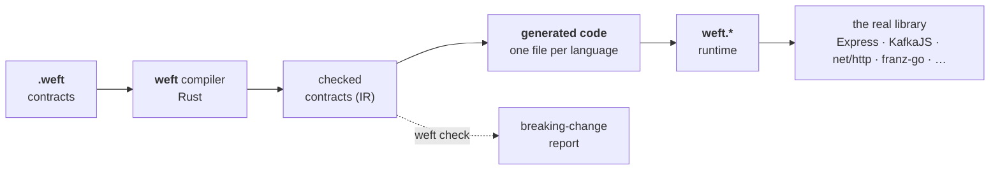

<div align="center">


# Weft

### One interface for every way services talk.

Write your contracts once. Call `weft.http`, `weft.gql`, `weft.grpc`, `weft.kafka`, `weft.ws` and the rest,<br>
in any language. Weft runs the real library underneath: Express, Apollo, KafkaJS, Spring Kafka, FastAPI, franz-go.

<br>

[](https://www.npmjs.com/org/weft-sdk)
[](https://pkg.go.dev/github.com/weft-sdk/weft/go)
[](https://github.com/weft-sdk/weft/actions/workflows/conformance.yml)
[](https://github.com/weft-sdk/weft/actions/workflows/compiler.yml)
[](LICENSE)
[](compiler/)

[**Quick start**](#quick-start) &nbsp;·&nbsp;
[**Contracts**](#contracts) &nbsp;·&nbsp;
[**Transports**](#transports) &nbsp;·&nbsp;
[**Languages**](#languages) &nbsp;·&nbsp;
[**CLI**](#the-cli) &nbsp;·&nbsp;
[**Documentation**](#documentation) &nbsp;·&nbsp;
[**Contributing**](CONTRIBUTING.md)

</div>

<br>

---

## Overview

A modern system talks in many ways at once: REST for the frontend, GraphQL in front of it, gRPC between services, Kafka or RabbitMQ for events, WebSockets for live updates. Each comes with its own library, its own way to define types, its own errors, retries and tracing. Types drift between the service that sends and the one that receives. Every language repeats the work.

**Weft replaces that with one interface.** You describe what your services say to each other in small, language-neutral contract files. A compiler turns them into typed code for your language. You call `weft.*`, and Weft runs the library you already use underneath.

```ts
weft.http.post("/orders", ({ body }) => placeOrder(body))      // Express underneath
weft.kafka.on("order.placed", (order) => notifyCustomer(order)) // KafkaJS underneath
await weft.kafka.publish("order.placed", order)                 // a wrong payload does not compile
```

<br>

## Features

<table>
<tr>
<td width="33%" valign="top">

**One API**<br>
`weft.http`, `weft.gql`, `weft.grpc`, `weft.rpc`, `weft.ws`, `weft.sse`, `weft.kafka`, `weft.mq`, `weft.nats`, `weft.redis`, `weft.cloud`, `weft.mqtt` and `weft.pulsar`, the same in every language.

</td>
<td width="33%" valign="top">

**Typed end to end**<br>
Every route, event name and payload comes from the contract. The sender and every receiver share the same types, whatever language they are written in.

</td>
<td width="33%" valign="top">

**Your stack stays**<br>
Weft runs Express, Apollo, KafkaJS, Spring Kafka, FastAPI and the rest. `weft.http.raw` or `weft.kafka.raw` hands you the original object whenever you need it.

</td>
</tr>
<tr>
<td valign="top">

**Behaviour that matches**<br>
Validation, retries with backoff, dead letters, timeouts, deadlines, error format and event metadata work the same on every transport and in every language.

</td>
<td valign="top">

**Observable by default**<br>
OpenTelemetry traces and metrics on every call, with the trace carried across HTTP and messages, so one request is one trace across services and languages.

</td>
<td valign="top">

**Breaking changes caught**<br>
`weft check` compares your contracts with the last release and sorts every change into safe, risky or breaking, with the version bump it needs. It runs in CI.

</td>
</tr>
<tr>
<td valign="top">

**Generated code you can read**<br>
One file per project, in your language's own style, checked into your repository. Nothing hidden, nothing to install at build time.

</td>
<td valign="top">

**Proven the same everywhere**<br>
A shared conformance suite runs every language against the same cases, and pairs of languages talk to each other over real HTTP and Kafka on every change.

</td>
<td valign="top">

**A live map**<br>
The dashboard shows which services talk to which, over what, with live traffic. Run it locally, self-host it, or use Weft Cloud.

</td>
</tr>
</table>

<br>

## How it works



| Step | What happens |
| --- | --- |
| **1. Set up** | `weft init` detects your language and package manager, asks which transports and libraries you use, installs the packages, writes `weft.yaml` and an example contract. |
| **2. Write contracts** | A contract is a name and a type, written once in a `.weft` file. The compiler checks every contract together, across packages. |
| **3. Generate** | `weft gen` writes one typed file for your language: the types, the route and event maps, and the checked contracts the runtime reads. |
| **4. Call** | You call `weft.*`. The runtime validates, encodes, traces and retries, and the real library does the transport. |

<br>

## Quick start

### TypeScript

```sh
cargo install --git https://github.com/weft-sdk/weft weft-cli --locked   # the weft CLI

weft init        # choose transports, write weft.yaml, install @weft-sdk/* packages, generate src/weft.gen.ts
```

```ts
import { weft } from "./weft.gen"

weft.http.post("/orders", ({ body }) => placeOrder(body))      // body is a typed CreateOrder
weft.kafka.on("order.placed", (order) => notifyCustomer(order)) // order is a typed Order

await weft.start()                                              // weft.stop() shuts down cleanly
```

### Go

```sh
go mod init example.com/shop
weft init        # detects go.mod, runs go get and go mod tidy, writes weft.gen.go
```

```go
w, _ := New(Options{})                                           // from weft.gen.go

w.HTTP.HandleCreateOrder(func(ctx context.Context, in CreateOrderInput) (OrdersOrder, error) {
	return placeOrder(ctx, in.Body)                              // in.Body is a typed CreateOrder
})
w.Kafka.OnOrderPlaced(func(ctx context.Context, o OrdersOrder, mc *weft.MessageContext) error {
	return notifyCustomer(ctx, o)                                // o is a typed Order
}, weft.SubscribeOptions{})

_ = w.Start(ctx)                                                 // w.Stop(ctx) shuts down cleanly
```

| Package | Install |
| --- | --- |
| [`@weft-sdk/core`](https://www.npmjs.com/package/@weft-sdk/core) | `npm install @weft-sdk/core` |
| [`@weft-sdk/http-express`](https://www.npmjs.com/package/@weft-sdk/http-express) | `npm install @weft-sdk/http-express express` |
| [`@weft-sdk/kafka-kafkajs`](https://www.npmjs.com/package/@weft-sdk/kafka-kafkajs) | `npm install @weft-sdk/kafka-kafkajs kafkajs` |
| Go module | `go get github.com/weft-sdk/weft/go` |

<br>

## Contracts

Contracts are written in `.weft`, a small language made for describing what services say to each other. It has types, enums, unions, events, errors and one block for each kind of transport. Contracts import each other, carry a version, and are checked together.

```weft
package orders @version("1.0.0")

enum Currency { EUR GBP USD }

type Money {
  amount: int            // minor units (cents)
  currency: Currency
}

/// An order placed by a customer.
type Order {
  id: uuid
  customerId: string
  items: OrderItem[]
  total: Money
  note?: string
  placedAt: timestamp
}

error OutOfStock { sku: string }

// Events: sent through a broker
event order.placed: Order { key: id }
event order.cancelled: { id: uuid, reason: string }

// Routes: request and response over HTTP
http /v1 {
  POST "/orders"       createOrder(body: CreateOrder) -> Order | OutOfStock | InvalidInput
  GET  "/orders/{id}"  getOrder(id: uuid) -> Order?
  GET  "/orders"       listOrders(query: { page?: int }) -> Order[]
}

// Services: gRPC or typed RPC
rpc Orders {
  createOrder(CreateOrder) -> Order
  streamUpdates(id: uuid) -> stream Order
}

// Queries, mutations and subscriptions
graphql {
  query        order(id: uuid) -> Order?
  mutation     placeOrder(input: CreateOrder) -> Order
  subscription orderUpdated(id: uuid) -> Order
}

// Live connections
socket tracking {
  server courier.moved: { orderId: uuid, lat: float, lng: float }
  client track.start:   { orderId: uuid }
}
```

The same contract gives every language the same types. `weft fmt` formats it, `weft check` guards it, and `weft gen` turns it into code. The full language is in [docs/02-contract-language.md](docs/02-contract-language.md).

<br>

## Transports

| Transport | What it is for | Libraries Weft runs underneath |
| --- | --- | --- |
| `weft.http` | REST and request/response APIs | Express, Fastify, Hono, NestJS · net/http, chi, gin, echo, fiber · FastAPI, Flask, Django · Spring Web, Ktor · ASP.NET Core · axum · Rails · Laravel · Phoenix · Vapor |
| `weft.gql` | GraphQL | Apollo Server, GraphQL Yoga · gqlgen · Strawberry · Spring GraphQL · Hot Chocolate · async-graphql |
| `weft.grpc` | Typed service-to-service calls | grpc-js, Connect · grpc-go, connect-go · grpcio · grpc-java · Grpc.Net · tonic |
| `weft.rpc` | Typed RPC over HTTP | tRPC in TypeScript, Weft's own protocol elsewhere |
| `weft.ws` | WebSockets | Socket.io, ws · gorilla/websocket, coder/websocket · python-socketio · SignalR · tokio-tungstenite |
| `weft.sse` | Server-sent events | Built on each language's HTTP library |
| `weft.kafka` | Event streaming | KafkaJS · franz-go, sarama, kafka-go · confluent-kafka · spring-kafka · Confluent.Kafka · rust-rdkafka |
| `weft.mq` | RabbitMQ and AMQP | amqplib · amqp091-go · pika · spring-amqp · RabbitMQ.Client · lapin |
| `weft.nats` | NATS | The official NATS client in each language |
| `weft.redis` | Redis Pub/Sub and Streams | ioredis, node-redis · go-redis · redis-py · Lettuce · StackExchange.Redis · redis-rs |
| `weft.cloud` | AWS SQS, SNS and EventBridge, Google Pub/Sub, Azure Service Bus | The official cloud SDK in each language |
| `weft.mqtt` | MQTT and IoT | MQTT.js · paho · MQTTnet · rumqttc |
| `weft.pulsar` | Apache Pulsar | The official Pulsar client in each language |

The full matrix of languages, libraries and versions is in [docs/05-languages.md](docs/05-languages.md).

<br>

## Languages

| Language | Runs on | Status |
| --- | --- | :---: |
| **TypeScript / JavaScript** | Node.js, Bun, Deno, browsers | ● |
| **Go** | Go 1.26 or later | ● |
| Python | FastAPI, Flask, Django, asyncio | ○ |
| JVM: Java, Kotlin, Scala | Spring, Ktor, Quarkus, Vert.x | ○ |
| .NET: C#, F# | ASP.NET Core | ○ |
| Rust | axum, actix-web, tokio | ○ |
| Ruby | Rails, Sinatra | ○ |
| PHP | Laravel, Symfony | ○ |
| Elixir, Erlang | Phoenix, Plug | ○ |
| Swift | Vapor, iOS | ○ |
| Dart, Flutter | shelf, mobile | ○ |

&nbsp;&nbsp;● available now &nbsp;&nbsp; ○ on the [roadmap](docs/12-roadmap.md)

TypeScript and Go ship with `weft.http` (Express and net/http) and `weft.kafka` (KafkaJS and franz-go), and they are tested against each other: a Go service and a TypeScript service read each other's HTTP calls and Kafka messages. Each further language is a package that passes the same conformance suite.

<br>

## The CLI

One binary, `weft`, written in Rust. It works the same in every project.

| Command | What it does |
| --- | --- |
| `weft init` | Detect the language, choose transports and libraries, install the packages, write `weft.yaml` and a first contract, and generate the code |
| `weft gen` | Generate typed code from the contracts. `--check` fails when the file is out of date (for CI), `--watch` regenerates on save |
| `weft check` | Detect breaking changes against a git tag, branch or commit. `--json` writes the result for other tools |
| `weft fmt` | Format `.weft` files. `--check` fails when something is unformatted |

```console
$ weft check
Comparing with git v1.0.0

orders (version 1.0.0)
  breaking  Order.note  removed field `note` from `Order`
                        hint: mark it `@deprecated` first, and remove it in the next major version
  1 breaking, 0 risky, 0 safe
  ✗ breaking changes need a major version bump; the version is 1.0.0
```

The CLI is documented in [docs/06-cli.md](docs/06-cli.md), including the `weft.yaml` file.

<br>

## Behaviour that is the same everywhere

| | |
| --- | --- |
| **Validation** | Every payload is checked against its contract on the way in and out. A bad one is rejected with a precise path, and never reaches your handler. |
| **Errors** | HTTP errors follow RFC 9457 problem details. Errors you declare in a contract map to the right status. |
| **Messaging** | Events travel in a CloudEvents envelope with a key, a type and a trace. A handler that throws is retried with backoff, then sent to a dead-letter topic. |
| **Deadlines** | Timeouts and deadlines carry from the caller through every hop, and cancel the work when they pass. |
| **Lifecycle** | `weft.start()` and `weft.stop()` open and close every transport in order, and drain in-flight work on shutdown. |
| **Tracing** | OpenTelemetry spans and metrics on every call, joined across services by the trace context. |
| **Config** | `weft.yaml` with `${ENV}` substitution, read the same way in every language. |

<br>

## Repository

| Path | What is in it |
| --- | --- |
| [`compiler/`](compiler/) | The Rust workspace: the parser, checker, compatibility checker, formatter, code generators, conformance harness and the `weft` CLI |
| [`sdks/typescript/`](sdks/typescript/) | The TypeScript packages: core, the Express adapter and the KafkaJS adapter |
| [`go/`](go/) | The Go module: core, the net/http adapter and the franz-go adapter |
| [`conformance/`](conformance/) | The shared test suite, and the [compatibility table](conformance/compatibility.md) it produces |
| [`spec/`](spec/) | The language-neutral specs: shared behaviour, the runner protocol and the IR schema |
| [`website/`](website/) | The Weft website, built with Astro |
| [`docs/`](docs/) | The documentation and the decision records |

<br>

## Documentation

| | |
| --- | --- |
| [Concepts](docs/01-concepts.md) | Contracts, transports, adapters, packages and code generation |
| [Contract language](docs/02-contract-language.md) | The `.weft` language and how contracts evolve safely |
| [API](docs/03-api.md) | The `weft.*` API for each transport, with examples in several languages |
| [SDK design](docs/04-sdk-design.md) | How a language package is built, and the behaviour all of them share |
| [Languages](docs/05-languages.md) | Every language and the library behind each transport |
| [CLI](docs/06-cli.md) | The commands and the `weft.yaml` file |
| [Conformance](docs/07-conformance.md) | The test suite that keeps every language the same |
| [Dashboard](docs/08-dashboard.md) | The service map and live traffic |
| [Architecture](docs/09-architecture.md) | How the pieces fit together |
| [Decisions](docs/decisions/) | Why each major choice was made |
| [Roadmap](docs/12-roadmap.md) | What is done and what comes next |

<br>

## Community

- **Questions and ideas:** open a [discussion](https://github.com/weft-sdk/weft/discussions) or an [issue](https://github.com/weft-sdk/weft/issues).
- **Contributing:** read [CONTRIBUTING.md](CONTRIBUTING.md) for how to build, test and send a change.
- **Security:** report a vulnerability privately through [GitHub security advisories](https://github.com/weft-sdk/weft/security/advisories/new). See [SECURITY.md](SECURITY.md).

<br>

## License

Weft is open source under the [Apache License 2.0](LICENSE). The compiler, the CLI, every language package, every adapter and the local dashboard are free to use. Weft Cloud, the hosted dashboard with teams, SSO and alerts, is the paid product.

<br>

<div align="center"><sub>Contracts in, typed code out.</sub></div>
